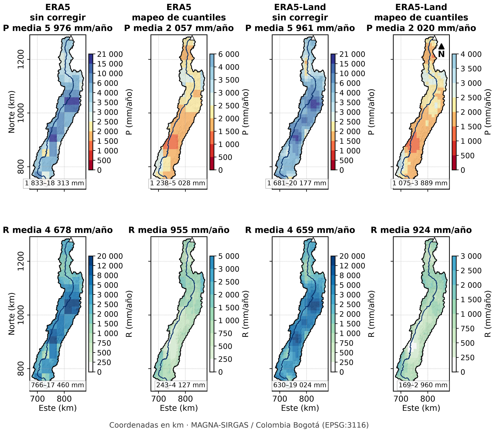

# Cómo se habría corregido el sesgo de ERA5 y ERA5-Land

En la cuenca, ERA5 y ERA5-Land triplican la lluvia del IDEAM (≈ 5970 frente a 1985 mm/año). Además, ubican mal su patrón espacial
(r ≈ −0,06) y adelantan el máximo del ciclo anual a abril–mayo. En el trabajo se evaluaron sin corregir, como pide el enunciado.
Este documento resume cómo se habría podido corregir el sesgo y qué se ganaría con ello.

## Por qué hay que corregirlo

- **No hay calibración con estaciones.** La precipitación de ERA5 se acumula a partir de pronósticos de corto plazo del modelo, y
  ERA5 no asimila pluviómetros (Hersbach et al., 2020).
- **ERA5-Land no la mejora.** Interpola linealmente la lluvia de ERA5 a 9 km (Muñoz-Sabater et al., 2021), así que hereda el mismo
  sesgo.
- **La topografía no se resuelve.** A 11–28 km de resolución desaparecen el valle interandino y su sombra de lluvia. Posada-Marín et
  al. (2019) encontraron el mismo problema con ERA-Interim en esta región.

## Métodos posibles

| Método | Qué corrige | Qué necesita | Limitación en esta cuenca |
|---|---|---|---|
| **1. Escalamiento lineal mensual** (*linear scaling*): P_corr(x, t) = f_m(x) · P_ERA5(x, t), con f_m(x) = P̄_IDEAM,m(x) / P̄_ERA5,m(x) | Media y ciclo anual, celda a celda | Las 12 normales mensuales del IDEAM interpoladas (ya calculadas, punto 13) | No corrige la varianza ni el momento de los eventos |
| **2. Mapeo de cuantiles** (*quantile mapping*, empírico o con distribución gamma) | Toda la distribución: media, varianza, extremos y frecuencia de días secos | Series de lluvia por estación (diarias o mensuales), no solo normales | En el trabajo solo se usaron normales; habría que descargar las series de DHIME |
| **3. Fusión con estaciones** (kriging de residuos o kriging con deriva externa usando ERA5) | Patrón espacial y magnitud, como hace CHIRPS con el satélite | Estaciones y el campo de ERA5 | El patrón espacial de ERA5 no se parece al observado (r ≈ −0,06), así que como deriva no aporta; solo servirían sus anomalías temporales |
| **4. Corrección con el balance hídrico** (factor de «P necesaria») | La lámina que el caudal exige, por área de drenaje | Caudales observados | Ya calculada: reducciones del 47 % al 74 %. Pero el balance queda corregido con el mismo caudal con que luego se valida, así que habría que calibrar en unas estaciones y validar en otras |
| **5. Reducción de escala dinámica** (WRF) | La física: valle, laderas y convección a 1–4 km | Gran capacidad de cómputo | Posada-Marín et al. (2019) muestran que mejora a ERA-Interim en el valle del Cauca, pero se sale del alcance del trabajo |

## Prueba rápida del método 1

Se calcularon factores mensuales con el promedio de la cuenca, f_m = P_IDEAM,m / P_ERA5,m, y se aplicaron a la serie mensual de
ERA5 para 1981–2010.

- **Factores:** de 0,22 (agosto) a 0,45 (noviembre). Corregir ERA5 exige quitarle entre la mitad y las tres cuartas partes de la
  lluvia, y más en la temporada seca de mitad de año.
- **Media:** la lluvia anual corregida da 1998 mm/año, igual a la del IDEAM, porque así está construida la corrección. Por eso el
  balance de largo plazo con ERA5 corregido no es una prueba independiente: reproduciría el del IDEAM.
- **Prueba independiente: la variabilidad interanual.**

| Lluvia anual de la cuenca | r con Q anual de Bolombolo | r con Q anual de La Pintada | r con Q anual de Puerto Valdivia | CV interanual |
|---|---|---|---|---|
| CHIRPS v2.0 | 0,92 | 0,94 | 0,91 | 10,8 % |
| ERA5 corregido | 0,56 | 0,58 | 0,77 | 6,9 % |
| ERA5-Land corregido | 0,57 | 0,59 | 0,79 | 7,2 % |

(Correlaciones anuales 1981–2010; n = 29, 30 y 19 años. El factor mensual no cambia la correlación anual de forma apreciable.)

El escalamiento corrige la media y el ciclo, pero no lo que ERA5 hace mal en el tiempo: ubica peor los años húmedos y secos y
subestima la variabilidad interanual. Sus anomalías mensuales se correlacionan apenas 0,63–0,66 con las de CHIRPS.

## ¿Es la resolución? Prueba directa (`codigo/27_sensibilidad_resolucion.py`)

| Precipitación usada en el balance | P (mm/año) | Error en el cierre |
|---|---|---|
| IDEAM a 90 m (base) | 1985 | −5,3 % |
| IDEAM degradado a 0,25° (celda de ERA5) | 1985 | −5,6 % |
| IDEAM degradado a 0,1° (celda de ERA5-Land) | 1985 | −5,4 % |
| ERA5 → 90 m, vecino más cercano / bilineal | 5976 / 5972 | +392 % / +391 % |

Las dos pruebas apuntan a lo mismo:

- La lluvia observada, vista con la celda de ERA5, sigue cerrando el balance.
- Remuestrear ERA5 no cambia su error.

El factor 3 no viene del tamaño de la celda, sino de la lluvia que produce el modelo.

Las unidades también se verificaron. En la Amazonia y los Llanos, ERA5 coincide con CHIRPS (razón de 0,89 a 0,98). La razón crece
hacia los Andes y llega a ≈ 3 en esta cuenca.

## Mapeo de cuantiles aplicado (`codigo/28_quantile_mapping.py`, `codigo/29_figura_quantile_mapping.py`)

**Cómo se aplicó:**
- Mapeo de cuantiles empírico, por celda y mes calendario.
- Referencia: CHIRPS v2.0 promediado en la celda de cada reanálisis. Del IDEAM solo hay normales, no series.
- Evaluación sin circularidad: se calibró con 1981–1995 y se validó con 1996–2010. El balance se comparó con los caudales observados,
  que el método no usa.

| Fuente | P (mm/año) | Error en el cierre | Error abs. medio, 9 estaciones | r espacial con el IDEAM | CV interanual | r anual P–Q (Bolombolo / La Pintada / Pto. Valdivia) |
|---|---|---|---|---|---|---|
| IDEAM (kriging) | 1985 | −5,3 % | 4,5 % | — | — | — |
| CHIRPS v2.0 | 2026 | −2,2 % | 5,3 % | 0,89 | 10,8 % | 0,92 / 0,94 / 0,91 |
| ERA5 sin corregir | 5976 | +392 % | 447 % | −0,06 | 7,1 % | 0,56 / 0,58 / 0,78 |
| ERA5 corregido | 2057 | +0,5 % | 6,7 % | 0,81 | 8,7 % | 0,62 / 0,64 / 0,82 |
| ERA5-Land sin corregir | 5961 | +390 % | 452 % | −0,06 | 7,6 % | 0,58 / 0,59 / 0,79 |
| ERA5-Land corregido | 2020 | −2,7 % | 5,2 % | 0,88 | 9,6 % | 0,62 / 0,64 / 0,82 |

**Validación (1996–2010):**
- El sesgo frente a CHIRPS pasa de +184 % a −2,7 % en ERA5 y de +193 % a −1,5 % en ERA5-Land.
- La correlación mensual sube de 0,71–0,76 a 0,91.

**Qué corrige y qué no:**
- Corrige la media, el ciclo (máximo en octubre), el patrón espacial y el balance.
- Pero todo eso viene de la referencia: el ERA5 corregido es, en esencia, CHIRPS visto con la celda del reanálisis.
- Lo único propio de ERA5 que sobrevive es la secuencia temporal, que sigue siendo débil: r de 0,62–0,82 con el caudal anual, frente a
  0,91–0,94 de CHIRPS.

## Recomendación

1. **Para un balance de largo plazo**, corregir ERA5 no aporta nada: el resultado es, por construcción, la climatología de las
   estaciones. Conviene usar el IDEAM o CHIRPS.
2. **Si se necesitara ERA5**, por ejemplo por sus otras variables (radiación, viento, humedad) o para series largas en tiempo real,
   lo mínimo es:
   - un mapeo de cuantiles mensual con series de estaciones del IDEAM;
   - una validación cruzada dejando estaciones fuera;
   - una verificación independiente con la variabilidad interanual de los caudales, como la de la tabla anterior.
3. **CHIRPS ya es**, en la práctica, un producto satelital corregido con estaciones (Funk et al., 2015). Por eso supera a ERA5 en
   la media, en el patrón espacial y en la variabilidad interanual.

## Referencias

- Funk, C. et al. (2015). The climate hazards infrared precipitation with stations—a new environmental record for monitoring
  extremes. *Scientific Data*, 2, 150066.
- Gudmundsson, L., Bremnes, J. B., Haugen, J. E. y Engen-Skaugen, T. (2012). Downscaling RCM precipitation to the station scale
  using statistical transformations – a comparison of methods. *Hydrology and Earth System Sciences*, 16, 3383–3390.
- Hersbach, H. et al. (2020). The ERA5 global reanalysis. *Quarterly Journal of the Royal Meteorological Society*, 146, 1999–2049.
- Muñoz-Sabater, J. et al. (2021). ERA5-Land: a state-of-the-art global reanalysis dataset for land applications. *Earth System
  Science Data*, 13, 4349–4383.
- Posada-Marín, J. A., Rendón, A. M., Salazar, J. F., Mejía, J. F. y Villegas, J. C. (2019). WRF downscaling improves ERA-Interim
  representation of precipitation around a tropical Andean valley during El Niño. *Climate Dynamics*, 52, 3609–3629.
- Teutschbein, C. y Seibert, J. (2012). Bias correction of regional climate model simulations for hydrological climate-change
  impact studies: Review and evaluation of different methods. *Journal of Hydrology*, 456–457, 12–29.
